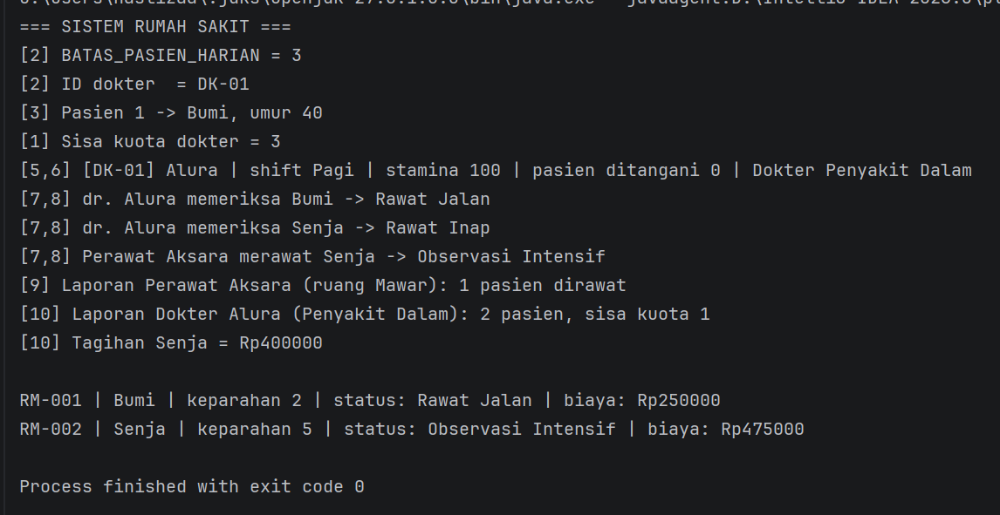

# Responsi Praktikum Pemrograman Berorientasi Objek

- **Nama** : Hasliza Syakina Ramadhani
- **NIM** : H1D025037
- **Tema** : Rumah Sakit

## Deskripsi
Program simulasi rumah sakit berbasis Java. Dokter dan perawat (tenaga medis)
melayani pasien. Kondisi pasien (tingkat keparahan) dan kondisi tenaga medis
(stamina dan kuota harian) menentukan status pasien serta biaya perawatan.

## Struktur Class
| File | Peran |
|---|---|
| `TenagaMedis.java` | Superclass **abstract** (konstanta, atribut final, overloaded constructor, abstract method) |
| `Dokter.java` | Subclass, `implements DapatDilaporkan, BisaDitagih` |
| `Perawat.java` | Subclass, `implements DapatDilaporkan` |
| `Pasien.java` | Entitas pasien |
| `DapatDilaporkan.java`, `BisaDitagih.java` | Interface |
| `Main.java` | Pengujian|

## Langkah Compile dan Run
1. Masuk ke folder yang berisi file `.java`
2. Compile semua file:
```bash
   javac *.java
```
3. Jalankan program:
```bash
   java Main
```

## Screenshot Output

